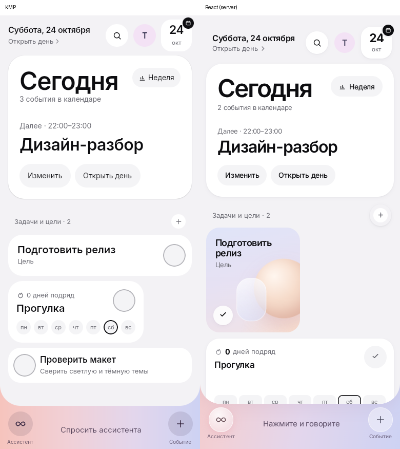
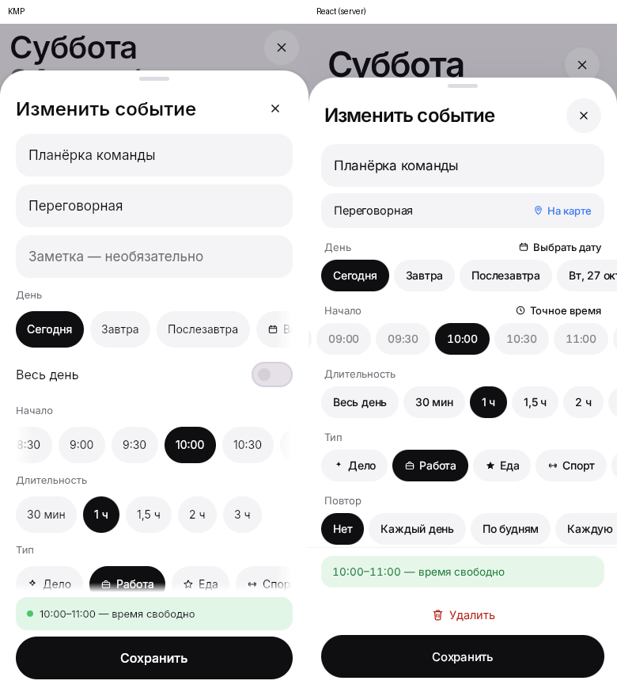
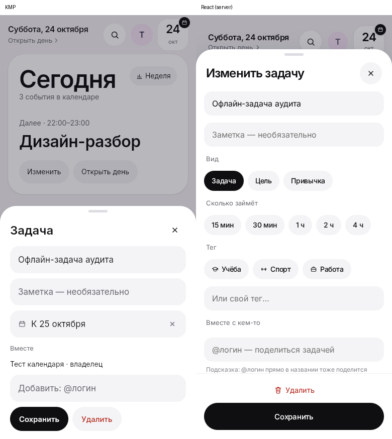
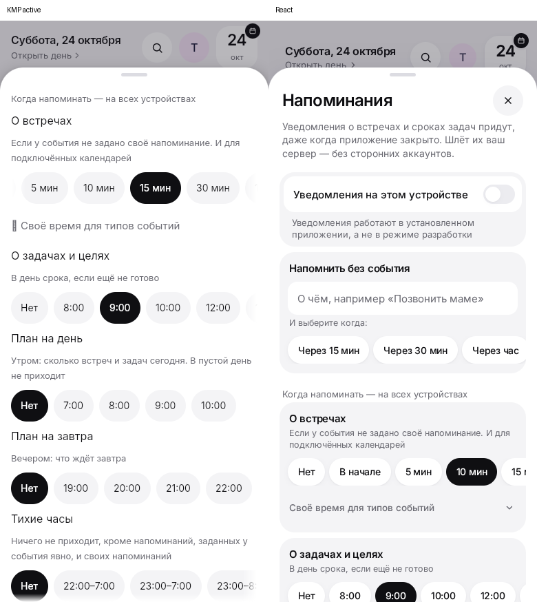
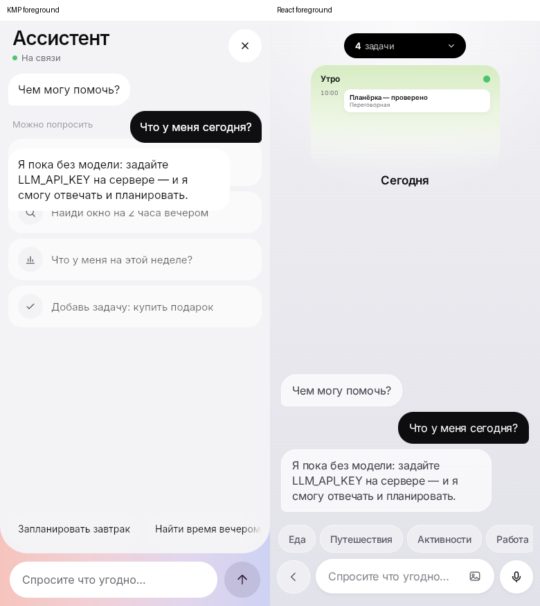
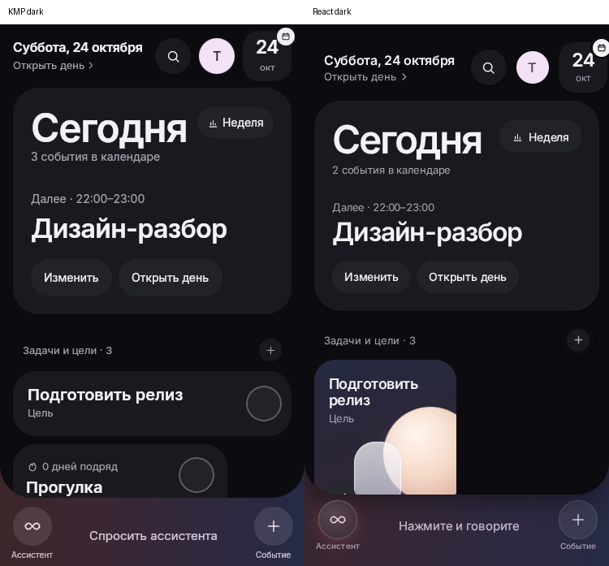

# Интерактивный аудит KMP и сравнение с React — 24 октября 2026

Проверка завершена. Версия KMP — `42e6ed4`.

Базовые действия с данными работают: создание, правка, поиск, отмена удаления, офлайн-очередь,
настройки и транспорт чата. При этом точного соответствия опубликованному React нет.
В Wasm подтверждены ошибочная начальная прокрутка «Напоминаний» и остаточные карточки примеров в чате;
также неполон редактор задачи и отсутствуют имена у части иконочных кнопок.

Предыдущие пять замечаний ревью исправлены в `42e6ed4`: 72 JVM-теста и сборки Wasm, JS, Android прошли,
CI GitHub для этого коммита зелёный. Неудачная публикация GitHub Pages — отдельная ранее обнаруженная настройка,
а не ошибка сборки KMP.

## Среда и границы

- KMP Wasm: локальная development-сборка, http://127.0.0.1:18090.
- Настоящий отдельный Go-сервер и файловое хранилище: http://127.0.0.1:18091.
- React: HTML, JS, CSS и шрифты с https://aicall.mish-tech.ru/.
  Запросы `/api/**` перенаправляются в тестовый локальный Go-сервер, чтобы сравнить одинаковые данные
  и не менять рабочие аккаунты. Это проверка опубликованного UI, а не продакшен-бэкенда.
- Chromium с SwiftShader для Skiko/WebGL, 390×844, светлая тема; отдельно — 375×667 и тёмная тема.
  Выводы о графических дефектах относятся к этому Wasm-окружению; их нельзя автоматически переносить на Android.
  Сравнение производительности debug-Wasm и production-React не проводилось.
- Реальные клики, ввод и касания. Скриншоты сохраняются после действий; промежуточные анимации
  исключаются из выводов. API также используется для проверки фактического сохранения.
- Мобильные клавиатура, вибрация, системная «Назад» и iOS требуют устройства и здесь не проверяются.

## Наблюдения по шагам

1. **Главная — функциональна, визуальное соответствие неполное.**
   KMP: `01-kmp-home.png`, React: `03-react-home-clean.png`.
   В KMP цель — белая строка во всю ширину с чекбоксом справа. В React — высокая цветная карточка
   с иллюстрацией; существенно отличаются композиция целей/привычек, отступы и нижняя панель.
   Счётчик событий: KMP — 3, React — 2 при двух встречах и одном событии на весь день.
   Это различие семантики счётчика, а не потеря события: оба клиента показывают его в дне.
2. **День и список — открываются.**
   `04-kmp-day.png`, `05-react-day.png`, `06-kmp-agenda.png`, `07-react-agenda.png`.
   В обоих клиентах есть встреча на весь день, временные встречи, переключение шкалы/списка и лента недели.
   В KMP all-day занимает строку во всю ширину, в React — компактный чип. Различаются плотность шкалы,
   оформление выбранного дня и градиенты.
3. **Открытие существующей встречи — разное число шагов.**
   `08-kmp-event-details.png`, `09-react-event-editor.png`, `10-kmp-event-editor.png`.
   React сразу открывает редактор, KMP — просмотр с дополнительной кнопкой «Изменить».
   В формах KMP заметка вынесена наверх, «Весь день» — отдельный переключатель; в React длительность
   содержит «Весь день», есть «Точное время» и ссылка «На карте». Компоновка заметно различается.
4. **Правка события — сохранение работает.**
   Через поле названия введено «Планёрка — проверено», нажато «Сохранить» (`11-kmp-event-saved.png`).
   Название изменилось в списке; GET настоящего Go API подтвердил сохранение с прежними временем 10:00–11:00
   и местом. Ошибок JavaScript нет.
5. **Создание события — работает.**
   `12-kmp-new-event.png`, `14-kmp-event-tomorrow.png`, `15-kmp-event-created.png`.
   Введено название, выбрано «Завтра», нажато «Создать». Go API вернул событие на 25 октября 09:00–10:00;
   клиент открыл нужный день и показал запись. Пустое название не даёт сохранить.
   Замечание по форме: в заголовке «Новое событие» нет явной кнопки закрытия, в отличие от редактора и React.
   Закрытие доступно через фон/свайп и системную навигацию.
6. **Доступность — часть имён присутствует, часть отсутствует.**
   Получено актуальное accessibility tree Wasm-страницы: события и дни имеют имена
   («Проверка создания, 9:00–10:00»), «Изменить» и «Удалить» доступны по роли button.
   При этом кнопки закрытия, стрелки недели и иконочные действия выведены как button без имени.
   Это проверка браузерного дерева, не полноценный тест скринридером.
7. **Удаление с отменой — работает.**
   Созданное событие открыто, нажато «Удалить» (`17-kmp-delete-undo.png`): оно исчезло из списка,
   появилась кнопка «Вернуть». Нажатие «Вернуть» восстановило запись (`18-kmp-delete-restored.png`);
   GET Go API подтвердил, что событие осталось на сервере.
8. **Месяц — отображение и выбор даты работают, навигация отличается от React.**
   `20-kmp-month.png`, `21-kmp-month-selected.png`, `13-react-month.png`, `22-react-month-selected.png`.
   После создания события на завтра KMP показывает точку у 25 октября. Нажатие 25-го в KMP только меняет
   нижнюю карточку предпросмотра; в React то же нажатие сразу открывает день. В KMP нужен ещё один тап по карточке.
   В карточке KMP нет количества задач, которое есть в React. Размеры сетки, выбранный день и нижняя карточка
   также отличаются.
9. **Новая задача и подсказки — форма открывается, подсказки в KMP работают.**
   `23-kmp-new-task.png`, `24-react-new-task.png`, `25-kmp-task-suggestions.png`, `26-react-task-suggestions.png`.
   Основной состав формы близок: название, заметка, вид, оценка времени, тег и участники.
   При вводе «Пров» KMP предложил существующее «Проверить макет», опубликованный React — нет.
   Это наблюдаемое отличие опубликованных версий; `/api/health` сервера возвращает `version: dev`,
   поэтому точный коммит серверной версии по health определить нельзя.
10. **Офлайн-очередь пережила закрытие вкладки и отправилась на сервер.**
    Во вкладке KMP отключена сеть Chromium. Через форму создана «Офлайн-задача аудита».
    Клиент показал «Нет сети · 1 изменение ждёт» и задачу (`27-kmp-offline-task.png`,
    `28-kmp-offline-task-visible.png`). Отдельный GET локального Go API подтвердил: на сервере её ещё нет.
    Вкладка закрыта, сеть включена, приложение открыто заново. Задача появилась на сервере как `task-8`,
    в этом сценарии — один экземпляр, индикатор очереди исчез (`29-kmp-reconnected.png`).
    Это подтверждает конкретный сценарий, а не общую гарантию однократного replay при нескольких вкладках.
11. **Поиск — находит запись, созданную офлайн, в обоих клиентах.**
    `30-kmp-search.png`, `31-kmp-search-result.png`, `32-react-search.png`, `34-react-search-result.png`.
    Введено «Офлайн», найденная задача открыта в редакторе. В KMP у поиска автофокус, результат приходит
    от настоящего API, а не из подставленного ответа.
12. **Редактор задачи — набор полей не соответствует React.**
    `33-kmp-task-editor.png`, `37-react-task-editor.png`.
    KMP позволяет менять название, заметку, срок и участников. В нём нет изменения вида, оценки времени и тега,
    хотя эти поля есть при создании и в опубликованном редакторе React. После создания исправить их в KMP нельзя.
    Это функциональное расхождение, а не только другой отступ.
13. **Выбор срока — работает, но вид и язык выбиваются из приложения.**
    `35-kmp-task-due.png`, `36-kmp-task-due-selected.png`.
    Открывается стандартный Material DatePicker, выбран 25 октября, поле стало «К 25 октября».
    В Chromium с локалью по умолчанию en-US заголовки «Select date», «Selected date», «October 2026» и дни недели
    остаются английскими при русских «Отмена»/«Готово» и остальном интерфейсе. При явной локали ru-RU календарь полностью русский (`64-kmp-datepicker-ru-small.png`),
    на 375×667 помещается целиком. Поэтому это зависимость языка от локали браузера, а не отказ русской локализации.
    Выбранный срок `2026-10-25` сохранён кнопкой «Сохранить» и подтверждён GET Go API.
14. **Аккаунт — открывается, но плотность и состав меню отличаются.**
    `38-kmp-account.png`, `39-react-account.png`.
    В KMP более высокие строки, отдельный пункт «Люди», поэтому выход и часть уведомлений оказываются
    ниже первого экрана 390×844. В React кнопка выхода видна без прокрутки. Настройки темы доступны в обоих.
15. **Напоминания — подтверждена ошибочная начальная прокрутка.**
    - `40-kmp-reminders.png` и повторное открытие `44-kmp-reminders-reopened.png`: шторка сразу прокручена
      до настроек «Когда напоминать». Заголовок, закрытие, пояснение о push и создание своего напоминания скрыты.
      Повторяется после закрытия и открытия. В React первая страница начинается с заголовка (`41-react-reminders.png`).
      Вероятная причина по коду: `ChoicePill(reveal = true)` вызывает `bringIntoView` (`ui/Sheets.kt:561`),
      который прокручивает не только горизонтальный ряд, но и родительское вертикальное тело шторки.
    - Захват `43-kmp-sheet-wheel-stuck.png` с полным исчезновением шторки **не принят как итоговое доказательство**:
      повтор в активной вкладке (`62-kmp-wheel-foreground-stuck.png`, `65-kmp-wheel-large-foreground.png`)
      полного исчезновения не подтвердил. После прокрутки вверх заголовок доступен, но шторка остаётся ниже
      исходного положения примерно на 70px. Это менее серьёзный дефект/особенность веб-overscroll, требующая
      отдельной проверки трекпадом; в итоговый список блокирующих ошибок не включена.
      В коде `drag` завершается в `onPreFling` (`ui/Sheets.kt:222`, `:230`). Touch-прокрутка работает
      (`46-kmp-reminders-touch-scroll.png`).
      При этом настройка «О встречах: 15 мин» сохранилась: GET `/api/push` подтвердил `eventReminder: 15`
      (`45-kmp-reminder-setting-saved.png`). Настройки доставки в приложении не равны регистрации нативного push.
16. **Своё напоминание — создание работает.**
    После touch-прокрутки к блоку «Напомнить без события» введено «Проверка напоминания» и выбрано
    «Через 15 мин». Запись появилась в списке (`48-kmp-alarm-confirmed.png`), Go API подтвердил id 1
    и время в UTC. Доставка push не проверялась: у тестового аккаунта нет подписанных устройств.
17. **Чат — отправка, поток и история работают; внешний вид значительно отличается.**
    Введено «Что у меня сегодня?», нажата кнопка отправки. Локальный сервер без `LLM_API_KEY`
    вернул заглушку; реплика и ответ сохранены в истории (`52-kmp-chat-reply.png`).
    Это проверка транспорта и UI, не качества настоящей модели и не платный вызов.
    В React видны миниатюра расписания, меню задач, темы, вложения и микрофон; в KMP — шапка «Ассистент»,
    примеры запросов и отдельная строка быстрых подсказок. Это другой макет, а не точное соответствие.
    Для выводов об анимациях выполнены отдельные захваты после активации вкладок
    (`58-kmp-chat-foreground.png`, `59-react-chat-foreground.png`).
    **Дополнительный дефект чата (Wasm):** после первой отправки примеры запросов не исчезают визуально,
    а остаются под сообщениями полупрозрачными карточками. Видно в `compare-chat-foreground.png` и
    `60-kmp-chat-ghost-recheck.png`. Повторно проверено после активации вкладки, ожидания 2,4 секунды
    и ввода нового черновика; `document.visibilityState = visible`, `document.hasFocus() = true`.
    Это не только захват незавершённой анимации фоновой вкладки. В `ChatScreen.kt` блок Ideas удаляется
    из LazyColumn с `Modifier.animateItem()`: стоит проверить анимацию удаления/перерисовку слоя на Wasm.
    На Android этот дефект не проверен.
18. **375×667, тёмная тема и защита правок — работают.**
    `55-kmp-dark-small-home.png`, `56-react-dark-small-home.png`, `63-kmp-small-task-editor.png`.
    Форма задачи помещается, основные кнопки доступны. При перетаскивании ручки изменённой формы мышью
    появляется «Отбросить введённое?» (`67-kmp-small-dirty-drag.png`), шторка возвращается на место.
    «Остаться» сохраняет введённый текст (`68-kmp-small-draft-kept.png`).
    Инъекция touch через CDP в этом контексте не дала однозначного результата; успешный drag мышью
    не выдаётся за проверку жестов на телефоне. При локали ru-RU календарь русский и не обрезан
    (`64-kmp-datepicker-ru-small.png`). Светлая и тёмная темы переключены реальными кликами
    в аккаунте (`71-kmp-theme-light-selected.png`, `72-kmp-theme-dark-selected.png`).

19. **Вход, ошибка пароля и восстановление сессии — работают.**
    В отдельном чистом контексте подставлен только адрес локального API, без токена.
    Неверный пароль показал «Неверное имя или пароль» (`73-kmp-login-error.png`).
    После ввода верного пароля через форму открылась главная (`77-kmp-login-verified.png`),
    после полной перезагрузки сессия восстановилась (`78-kmp-session-verified.png`).
    Регистрация через UI в этом аудите не проверялась: тестовый аккаунт создан предварительно через API.

## Приоритеты по результату проверки

| Важность     | Что исправить                                                                               | Доказательства                                                                          |
| ------------ | ------------------------------------------------------------------------------------------- | --------------------------------------------------------------------------------------- |
| P2           | «Напоминания» открываются не с начала: скрыты заголовок, закрытие и собственные напоминания | `44-kmp-reminders-reopened.png`, `61-kmp-reminders-foreground.png`                      |
| P2           | После первого ответа в Wasm остаются полупрозрачные стартовые примеры под сообщениями       | `compare-chat-foreground.png`, `60-kmp-chat-ghost-recheck.png`                          |
| P2           | В редакторе задачи отсутствуют изменение вида, оценки времени и тега                        | `compare-task-edit.png`                                                                 |
| P2           | У ряда иконочных кнопок нет имени в браузерном accessibility tree                           | Шаг 6, дерево и DOM-проверка кнопок                                                     |
| P3           | Создание события без явного крестика закрытия                                               | `12-kmp-new-event.png`                                                                  |
| Соответствие | Главная, цели, привычки, чат, календарь и состав редакторов существенно отличаются от React | `compare-home.png`, `compare-chat.png`, `compare-event-editor.png`, `compare-month.png` |

Полное исчезновение шторки в фоне и английский календарь при en-US не включены в список подтверждённых ошибок:
в активной вкладке первый эффект полностью не воспроизвёлся, а при ru-RU календарь русский.

## Итоговые ограничения и состояние

- В основных KMP- и React-вкладках массивы необработанных `pageerror` остались пустыми. Ошибки сети
  во время офлайн-сценария созданы намеренно; это не заявление, что любых сообщений консоли не было.
- Не проверялись реальные FCM/APNs, нативный push, OAuth внешних календарей, настоящая LLM, iOS,
  клавиатура/вибрация/системная «Назад» физического телефона и полное соответствие WCAG.
- Дубли и потери при конкурентном replay нескольких вкладок этим сценарием не исключены.
- Дополнительно созданные событие и офлайн-задача удалены через локальный API;
  своё напоминание к этому моменту уже отсутствовало (GET — пустой список, DELETE — 404).
  исходное название встречи и настройка 10 минут восстановлены. Базовый тестовый аккаунт и его исходные
  записи оставлены в отдельном `/tmp/ai-calendar-functional-data`, а не в рабочих данных.
- Превью оставлено на http://127.0.0.1:18090, тестовый API — http://127.0.0.1:18091.
  Только во временном HTML превью адрес локального API подставляется при отсутствии сохранённого адреса;
  исходники KMP этим не изменены. Для нового браузера можно зарегистрировать отдельный локальный аккаунт.
- Новые замечания аудита зафиксированы, изменения дизайна и новые исправления по ним в этом проходе не вносились.

## Принятые сравнения

Слева — KMP, справа — React с сервера, с одним локальным тестовым источником данных.
Настройки и состояние менялись по ходу сценариев: отдельные выбранные значения на снимках могут отличаться;
это не считается визуальным дефектом.

